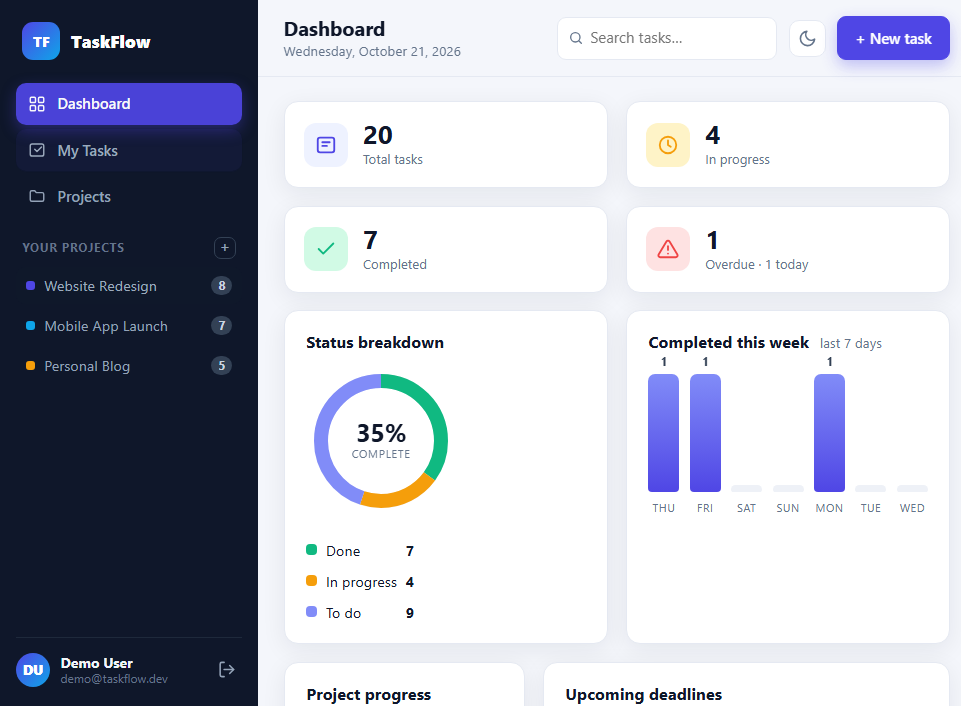
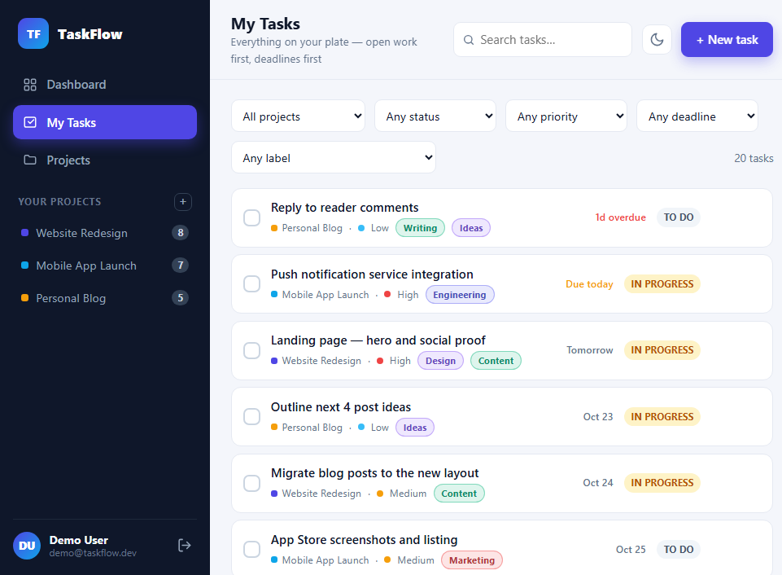
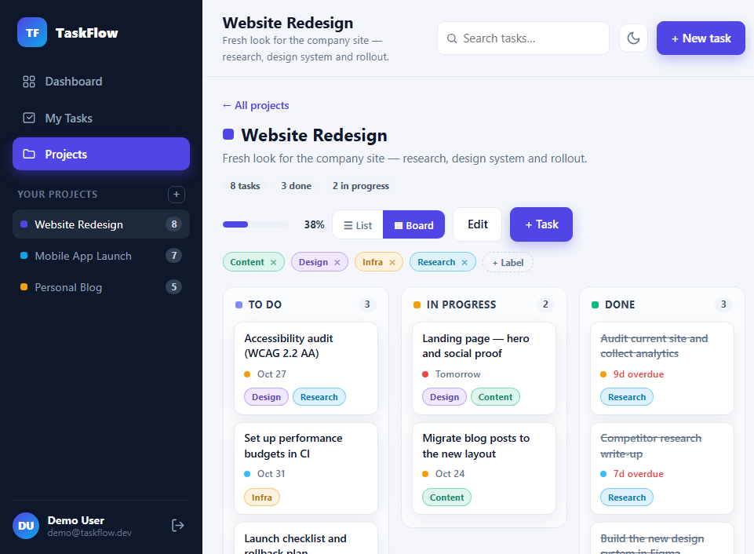
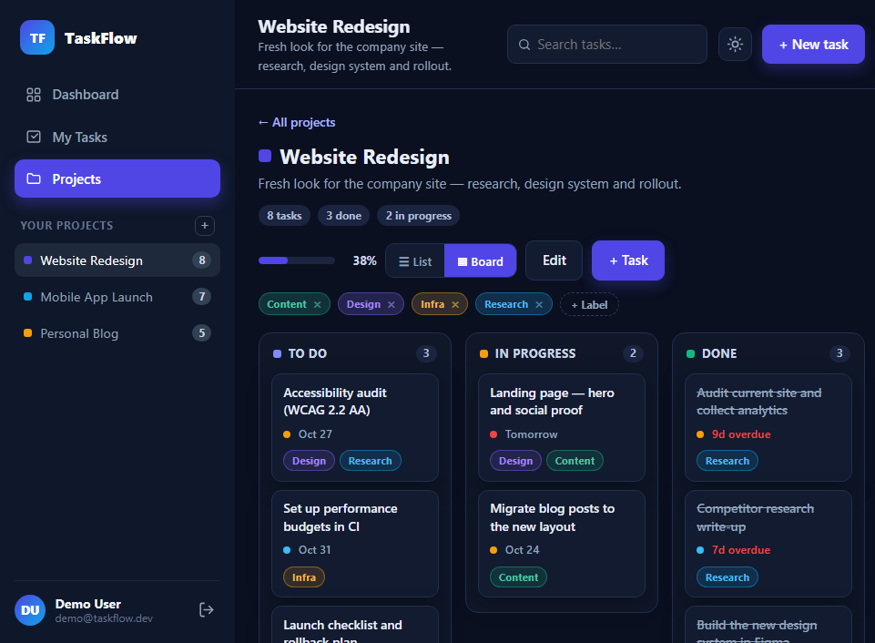
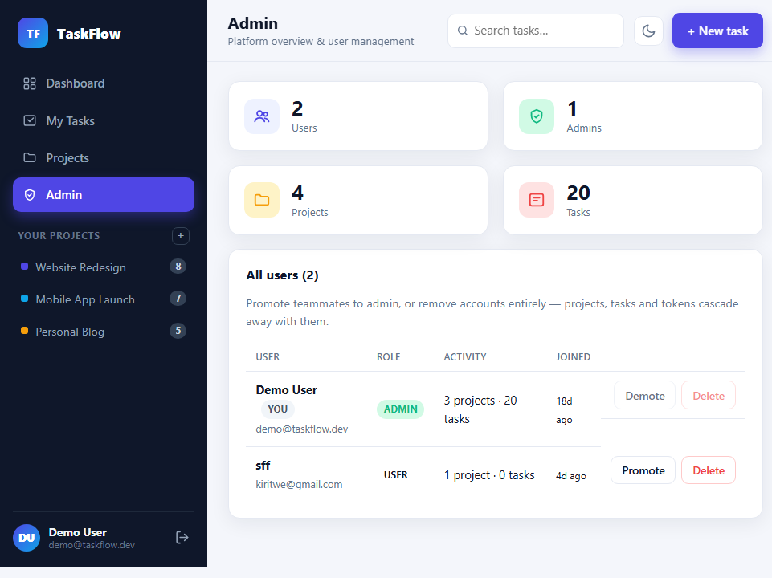
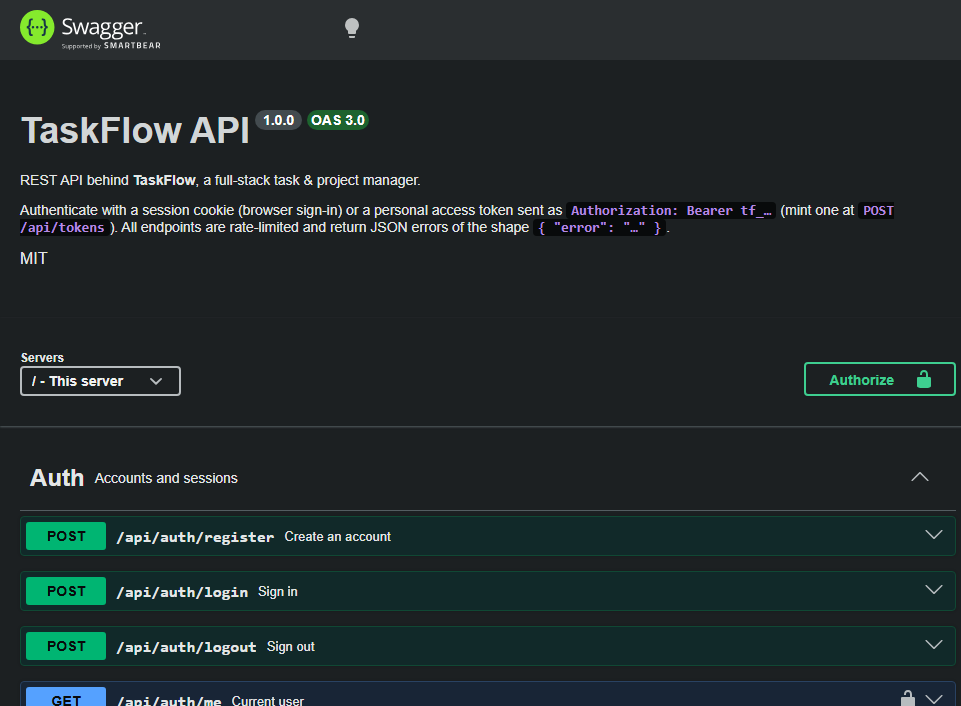

<div align="center">

# ✅ TaskFlow

**A full-stack task & project manager — built with Node.js, Express & SQLite.**

Projects, tasks, labels, deadlines, a drag-and-drop kanban board and a dashboard
that tells you exactly where you stand.

[](https://github.com/alshkylybdalslam/taskflow/actions/workflows/ci.yml)
[](#-testing--coverage)
[](https://nodejs.org/)
[](https://expressjs.com/)
[](https://sqlite.org/)
[](LICENSE)

</div>

---

## ✨ Features

- **🔐 Accounts & sessions** — register/login with bcrypt password hashing, hardened httpOnly session cookies (`SameSite=Lax`, `Path=/`, `Secure` over HTTPS) and **rate-limited** credential endpoints (brute-force protection)
- **🛡 Security hardening** — `helmet` with a strict Content-Security-Policy (`script-src 'self'`), HSTS, MIME-sniffing/referrer protections, a 64 KB JSON body limit (413 on overflow), a global per-IP rate limit and a production container that runs as a non-root user
- **👑 Admin panel** — role-based access (the first account on a fresh install becomes admin): platform-wide stats, user list with activity counts, create users on the fly, promote/demote and account deletion with full cascade
- **📁 Projects** — create colour-coded projects with live progress tracking
- **✔ Tasks** — status (`To do → In progress → Done`), priority, due dates, descriptions
- **🗂 Kanban board** — drag & drop tasks between columns (native HTML5 DnD, zero libraries), with a List ⇄ Board toggle remembered across visits
- **🏷 Labels** — project-scoped tags on a `task_labels` junction table; create, assign, filter and delete them from the UI
- **⏰ Deadlines** — due dates on every task, overdue highlighting, and *Overdue / Due today / No due date* filters
- **🔎 Filtering & search** — by project, status, priority, deadline, label, or free-text search
- **📊 Dashboard** — status donut, 7-day completion trend, per-project progress, upcoming deadlines and overdue alerts — all in a single API round trip
- **🔑 API tokens** — personal access tokens (`Bearer tf_…`) for scripted access; only the SHA-256 hash is stored, the secret is shown exactly once
- **📖 Interactive API docs** — OpenAPI 3.0.3 spec with Swagger UI at [`/api/docs`](http://localhost:3000/api/docs); machine-readable spec at `/api/docs.json`
- **🌗 Dark mode** — one-click theme toggle, persisted in `localStorage` and applied before first paint (no flash)
- **📱 Responsive UI** — polished single-page frontend with modals, toasts and empty states
- **🧪 Tested** — 46 integration tests covering auth, CRUD, ownership rules, labels, tokens, deadlines, rate limiting, security headers, the admin panel and the API docs

## 📸 Screenshots

| Dashboard | Tasks & filters |
|-----------|-----------------|
|  |  |

**Kanban board** — drag a card to change its status:



…and it looks just as good in dark mode:



**Admin panel** — platform stats and user management (visible to admins only):



## 🛠 Tech stack

| Layer      | Technology |
|------------|------------|
| Backend    | Node.js, Express 4 |
| Database   | SQLite via `better-sqlite3` (WAL mode, foreign keys) |
| Auth       | bcryptjs password hashing, opaque session tokens in httpOnly cookies, bearer API tokens, `express-rate-limit` on auth endpoints |
| Security   | `helmet` (strict CSP, HSTS, no-sniff…), global rate limiter, 64 KB JSON body limit, `Secure` cookies behind HTTPS |
| API docs   | OpenAPI 3.0.3 + Swagger UI (`swagger-ui-express`) at `/api/docs` |
| Frontend   | Vanilla JS SPA, hand-rolled SVG/CSS charts (no framework, no chart library) |
| Testing    | Node built-in test runner (`node --test`) + `fetch`, coverage via Node's built-in test coverage |
| Delivery   | GitHub Actions CI (Node 18, 20 & 22 + Docker image smoke test), multi-stage Dockerfile |

## 🚀 Quick start

```bash
git clone https://github.com/alshkylybdalslam/taskflow.git
cd taskflow
npm install
npm run seed     # optional: demo data
npm start        # → http://localhost:3000
```

**Demo account** (after seeding): `demo@taskflow.dev` / `demo1234`

### 🐳 Docker

```bash
docker build -t taskflow .
docker run -p 3000:3000 -v taskflow-data:/app/data taskflow
```

The SQLite file lives in the `/app/data` volume, so your data survives container
rebuilds. A built-in `HEALTHCHECK` keeps `docker ps` honest.

### Scripts

| Command              | What it does |
|----------------------|--------------|
| `npm start`          | Start the server on port 3000 (`PORT` env overrides) |
| `npm run dev`        | Start with auto-reload on file changes |
| `npm run seed`       | Load demo projects, tasks & labels (`-- --force` to reset) |
| `npm test`           | Run the integration test suite |
| `npm run coverage`   | Run the tests with Node's built-in coverage and print a table |

## 🔌 API overview

All endpoints are JSON. Protected routes accept **either** a session cookie
(browser) **or** `Authorization: Bearer tf_…` (scripts) — see
[API tokens](#-api-tokens).

> **📖 Interactive documentation:** open **[`/api/docs`](http://localhost:3000/api/docs)**
> for the full Swagger UI, or grab the raw OpenAPI 3.0.3 document at
> **`/api/docs.json`**.



| Method | Endpoint                | Description |
|--------|-------------------------|-------------|
| POST   | `/api/auth/register`    | Create an account *(rate-limited)* |
| POST   | `/api/auth/login`       | Sign in *(rate-limited)* |
| POST   | `/api/auth/logout`      | Sign out |
| GET    | `/api/auth/me`          | Current user |
| GET    | `/api/projects`         | List projects with task stats |
| POST   | `/api/projects`         | Create project |
| GET    | `/api/projects/:id`     | One project with task stats |
| PUT    | `/api/projects/:id`     | Update project |
| DELETE | `/api/projects/:id`     | Delete project (cascades tasks & labels) |
| GET    | `/api/tasks`            | List tasks — `?project_id= &status= &priority= &due= &label_id= &q=` |
| POST   | `/api/tasks`            | Create task (`label_ids` optional) |
| PUT    | `/api/tasks/:id`        | Update task (partial; `label_ids` replaces assignments) |
| DELETE | `/api/tasks/:id`        | Delete task |
| GET    | `/api/labels`           | All labels across my projects |
| DELETE | `/api/labels/:id`       | Delete a label (unassigns it everywhere) |
| GET    | `/api/projects/:id/labels`  | Labels of one project |
| POST   | `/api/projects/:id/labels`  | Create a label |
| POST   | `/api/tasks/:id/labels`     | Attach a label (`{ label_id }`) |
| DELETE | `/api/tasks/:id/labels/:labelId` | Detach a label |
| GET    | `/api/tokens`           | List my API tokens (never the secret) |
| POST   | `/api/tokens`           | Mint a token — returns the raw secret **once** |
| DELETE | `/api/tokens/:id`       | Revoke a token |
| GET    | `/api/dashboard`        | Summary, charts, deadlines, activity |
| GET    | `/api/admin/stats`      | Platform-wide counters *(admin)* |
| GET    | `/api/admin/users`      | Every user with activity counts *(admin)* |
| POST   | `/api/admin/users`      | Create an account (name/email/password/role) *(admin)* |
| PUT    | `/api/admin/users/:id`  | Promote / demote *(admin; never yourself)* |
| DELETE | `/api/admin/users/:id`  | Delete a user, data cascades *(admin)* |

`GET /api/tasks` deadline filters: `?due=overdue` · `?due=today` · `?due=none`

### Example

```bash
curl -c jar.txt -X POST http://localhost:3000/api/auth/login \
  -H "Content-Type: application/json" \
  -d '{"email":"demo@taskflow.dev","password":"demo1234"}'

curl -b jar.txt http://localhost:3000/api/dashboard
```

### 🔑 API tokens

```bash
# Mint a token (once — the secret is never shown again)
curl -b jar.txt -X POST http://localhost:3000/api/tokens \
  -H "Content-Type: application/json" -d '{"name":"my script"}'

# Use it from anywhere, no cookie needed
curl -H "Authorization: Bearer tf_..." http://localhost:3000/api/tasks
```

Only the SHA-256 hash of the token is stored server-side — the database is
useless to an attacker who exfiltrates it.

## 🏗 Architecture

```
taskflow/
├── server/
│   ├── index.js            # Express app: security middleware → API → docs → static → SPA
│   ├── db.js               # SQLite connection + schema (migrations-on-boot)
│   ├── seed.js             # Demo data generator (projects, tasks, labels)
│   ├── openapi.js          # OpenAPI 3.0.3 spec (served at /api/docs.json)
│   ├── middleware/
│   │   └── auth.js         # Sessions, cookies, requireAuth (cookie or bearer)
│   └── routes/
│       ├── auth.js         # Register / login / logout / me (+ rate limiting)
│       ├── admin.js        # Platform stats & user management (admin role)
│       ├── projects.js     # Project CRUD + stats
│       ├── tasks.js        # Task CRUD + filters + ownership checks
│       ├── labels.js       # Label CRUD + task attach/detach (junction table)
│       ├── tokens.js       # Personal access tokens (hash-only storage)
│       └── dashboard.js    # Aggregated stats in one round trip
├── public/                 # Frontend SPA (index.html, styles.css, app.js, theme.js)
├── tests/
│   └── api.test.js         # 46 integration tests (node --test)
├── docs/                   # README screenshots
├── .github/workflows/
│   └── ci.yml              # CI: npm ci + tests + coverage (Node 18, 20 & 22) + Docker build/smoke test
└── Dockerfile              # Multi-stage production image
```

**Key design decisions**

- **Layered ownership checks** — every task operation joins back to the owning user, so one user can never touch another's data, even by guessing IDs.
- **Zero-config database** — SQLite file in `/data` (git-ignored); tests run against `:memory:`.
- **One round-trip dashboard** — six aggregate queries composed server-side so the UI renders instantly.
- **Honest secrets** — passwords are bcrypt-hashed, session tokens are opaque randoms, API tokens are stored as SHA-256 hashes and shown exactly once.
- **Hardened by default** — strict CSP with no inline scripts anywhere, `Secure` cookies behind HTTPS, bounded request bodies and rate limiting at both the app and auth layers.
- **Pragmatic dependencies** — 6 runtime deps total; charts and drag-and-drop are hand-built with SVG/CSS and native HTML5.

## 🧪 Testing & coverage

```bash
npm test          # 46 tests, ~3s
npm run coverage  # same tests, built-in V8 coverage table
```

```
-------------------|---------|----------|---------|---------|
File               | % Stmts | % Branch | % Funcs | % Lines |
-------------------|---------|----------|---------|---------|
All files          |   96.66 |    80.17 |   94.16 |   96.66 |
-------------------|---------|----------|---------|---------|
```

CI runs the suite on every push and pull request against Node 18, 20 **and** 22, then builds the Docker image and smoke-tests it (seed-on-boot, server up, non-root user).

## 🗺 Roadmap

- [x] Drag & drop between statuses
- [x] REST API tokens for third-party access
- [x] Labels / tags on tasks
- [x] Deadline filters and overdue highlighting
- [x] CI + coverage reporting
- [x] Interactive API documentation (OpenAPI + Swagger UI)
- [x] Security hardening (CSP, rate limits, body limits, cookie flags)
- [x] Admin panel with roles and user management
- [ ] Due-date reminders and email notifications
- [ ] Team workspaces and task assignment
- [ ] PWA offline support

## 📄 License

MIT — free to use, modify and share.
